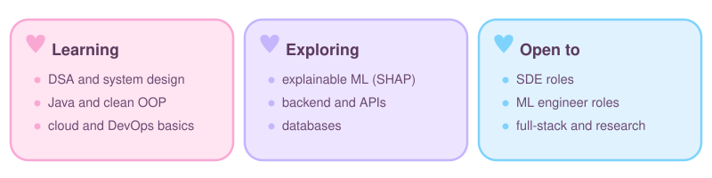
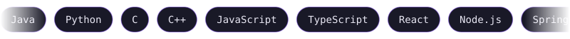

  

  
  
  

## ✦ Hi, I'm Rishika

I'm a final-year CSE student at SRMIST (graduating 2027) who likes turning ambiguous problems into clean, testable code. My work so far spans a Java desktop system backed by Oracle, a distributed job scheduler, an LLM-assisted analytics agent, and an explainable machine-learning research project (CropSight).

I care about readable code, honest evaluation, and understanding how systems behave under real constraints.

**Experience:** Project Software Analyst Intern at MECON Limited · Data Science Intern at 1Stop.ai

**Open to:** SDE, ML Engineer, Full-Stack and Research Engineering roles

 

## ✦ What I'm up to

  

## ✦ Terminal

  

## ✦ Tools

  

Cloud (AWS, Oracle Cloud) and Docker are at fundamentals and coursework level. My projects live in the pinned repositories above.

## ✦ How I build

- **Clarity over cleverness:** code is read far more often than it is written.
- **Iteration over perfection:** a shipped system that improves beats a perfect design that never exists.
- **Systems thinking:** every component lives in a larger context.
- **Depth over breadth:** understand why something works, not only that it does.

  Open to internships and early-career roles. If something here interests you, I'd be glad to talk. 
  <a href="mailto:dhanukarishika@gmail.com">Email</a> · <a href="https://www.linkedin.com/in/dhanukarishika/">LinkedIn</a> · <a href="https://leetcode.com/u/dhanukarishika_/">LeetCode</a>

