<div align="center">


**Software engineering · Machine learning · Building useful software**

<a href="mailto:dhanukarishika@gmail.com"></a>
<a href="https://www.linkedin.com/in/dhanukarishika/"></a>
<a href="https://leetcode.com/u/dhanukarishika_/"></a>

</div>

## About

```yaml
name     : Rishika Dhanuka
degree   : B.Tech Computer Science & Engineering, SRMIST (graduating 2027)
interests: Software engineering, machine learning, backend development, databases, cloud
research : Explainable ML for post-harvest risk scoring (CropSight)
open to  : SDE, ML Engineer, Full-Stack and Research Engineering roles
```

I'm a final-year CSE student who enjoys turning ambiguous problems into clean, testable code. My work so far spans a Java desktop system backed by Oracle, a distributed job scheduler, an LLM-assisted analytics agent, and an explainable machine-learning research project. I care about readable code, honest evaluation, and learning how systems behave under real constraints.

**Experience:** Project Software Analyst Intern at MECON Limited · Data Science Intern at 1Stop.ai

### Areas I work on and am growing in

- Problem decomposition and debugging
- Object-oriented programming and software design
- Machine learning pipelines, model evaluation and explainability
- Frontend and backend development, with database integration
- Cloud fundamentals (AWS, Oracle Cloud Infrastructure) and Docker

### Current focus

1. Data structures, algorithms, system design and interview preparation (LeetCode practice)
2. Software engineering fundamentals: Java, object-oriented design, maintainable code
3. Machine learning: preprocessing, model evaluation, explainability
4. Full-stack development: backend architecture, APIs, databases
5. Cloud infrastructure, DevOps basics and deployment concepts

## Featured Projects

### CropSight: explainable post-harvest risk scoring
Predicts post-harvest spoilage and food-waste risk from environmental and storage data, and explains each prediction. Compares Logistic Regression, Random Forest and Gradient Boosting, uses SHAP for explainability, and turns model probabilities into a risk score.
**Research:** accepted for presentation at ICONDEEPCOM 2026 and for publication in Springer conference proceedings.
   
[View repository](https://github.com/dhanukarishika/CropSight)

### Secure Asset Management System
Java desktop application for managing assets, built with a layered structure and an Oracle database behind it. Generates PDF reports with iText and sends email notifications through JavaMail.
   

### Distributed Job Scheduler
Distributed job-scheduling platform with a Java backend and a React/TypeScript front end, built as an internship project.
     
[View repository](https://github.com/dhanukarishika/distributed-job-scheduler)

### Customer Voice Intelligence Agent
Assignment for Havells' AI Catalyst program: analyses customer feedback with VADER sentiment scoring and retrieval-augmented answers (FAISS with Sentence-Transformers, Gemini API), served through a Streamlit interface.
  

### Data science internship work
Text classification with TF-IDF and Logistic Regression: hate-speech detection and SMS spam classification.

## Tech Stack

**Languages**      

**Web**     

**ML and data**    

**Databases**    

**Cloud and tools (fundamentals and coursework)**     

## GitHub Activity

<p align="center">
  
  
</p>

<p align="center">
  
</p>

<picture>
  <source media="(prefers-color-scheme: dark)" srcset="https://raw.githubusercontent.com/dhanukarishika/dhanukarishika/output/github-snake-dark.svg" />
  <source media="(prefers-color-scheme: light)" srcset="https://raw.githubusercontent.com/dhanukarishika/dhanukarishika/output/github-snake.svg" />
  
</picture>

## Engineering Philosophy

- **Clarity over cleverness:** code is read far more often than it is written.
- **Iteration over perfection:** a shipped system that improves beats a perfect design that never exists.
- **Systems thinking:** every component lives in a larger context.
- **Depth over breadth:** understand why something works, not only that it does.

---

<div align="center">

Open to internships and early-career roles. If something here interests you, I'd be glad to talk.

[Email](mailto:dhanukarishika@gmail.com) · [LinkedIn](https://www.linkedin.com/in/dhanukarishika/) · [LeetCode](https://leetcode.com/u/dhanukarishika_/)

</div>
